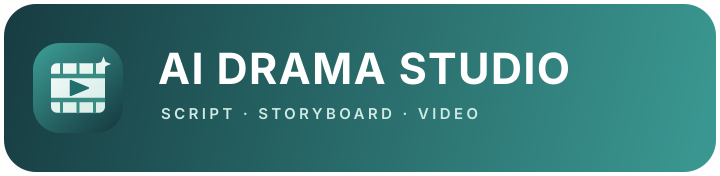

**物語をショートドラマに。**

[English](README.md) · [简体中文](README.zh-CN.md) · **日本語** · [한국어](README.ko.md)

[機能](#features) • [制作の流れ](#workflow) • [AI サービス](#models) • [ダウンロード](#download) • [QQ コミュニティ](#community) • [クレジット](#about)

 

## アイデアからショートドラマの完成まで

物語のアイデアや脚本を出発点に、執筆、ビジュアル開発、演出プラン、動画生成、書き出しまでを一つのワークスペースでつなぎます。ツール間の移動を減らし、物語やショットの表現に集中できます。

1. **脚本を読み込み、整理**してプロジェクトとエピソードを作成します。
2. AI でストーリーや台詞を**書き換え、ブラッシュアップ**します。
3. キャラクター、ロケーション、小道具、キャラクターの音声リファレンスを**共有アセットライブラリ**で管理します。
4. 演出方針、尺のルール、ストーリーボードの説明、動画プロンプトを使って**各エピソードを計画**します。
5. ショット動画を**生成・確認**し、タスクの進捗を追跡してから、クリップを結合しエピソードを書き出します。

## AI ショートドラマのクリエイター向け

- **制作の流れをひとつに。** 脚本、エピソード、再利用できるアセット、生成タスク、書き出しをプロジェクト単位で管理します。
- **作品のビジュアルに一貫性を。** キャラクター、ロケーション、小道具の参照素材を複数エピソードで再利用できます。キャラクターに音声リファレンスを紐付けると、登場するショットに自動で適用されます。
- **演出の主導権はクリエイターに。** プロジェクト共通のテキスト・画像・動画モデルを設定し、物語に合わせて特定エピソードの演出プランを調整できます。
- **プランから制作へスムーズに。** AI Agent が脚本の推敲、アセット抽出、ストーリーボード分割、プロンプト作成を支援します。創作上の判断はあなたが行えます。
- **生成前にモデルの制約を確認。** 選択した動画モデルの尺やプロンプト要件を事前に確認し、生成を始めてから互換性の問題に気付くリスクを減らします。
- English、简体中文、日本語、한국어の UI に対応しています。

## 好みの AI モデルを接続

利用するサービスのアカウントと API キーを設定し、制作工程ごとにモデルを選べます。単一の内蔵モデルだけに制作を限定しません。

- **文章制作・ストーリー開発：** OpenAI 互換のチャット API、Google Gemini、Volcengine、LK888 モデルハブ。
- **画像生成・編集：** OpenAI 互換の画像 API、Gemini の画像モデル、Volcengine、LK888 の画像モデル。
- **動画生成：** Volcengine Seedance、MiniMax H3、Alibaba Cloud Wan 3.0、AutoDL H3、LK888 の動画モデル。

利用可能なモデル、入力制限、機能はサービス提供元、アカウント権限、地域によって異なります。利用権限のあるサービスとモデルを設定してください。サービスのアカウント、API キー、利用料金は別途必要です。

## ダウンロード

最初のデスクトップ版は **Windows x64** に対応しています。インストーラーのサイズは約 **143 MiB** です。

現在の Windows インストーラーには署名がありません。初回起動時に Windows のセキュリティ警告が表示される場合があります。AI 機能を利用するには、アプリ内で設定するプロバイダーのアカウントと API キーが必要です。利用料金は各プロバイダーの条件に従います。

## クレジット

作者：[Lumosylva](https://github.com/Lumosylva) · [公式サイト](https://drama.madongdong.com)

[BSD 3-Clause License](LICENSE) のもとで公開されています。

## QQ コミュニティ

AI Drama Studio の QQ コミュニティで、使用感やご意見を共有し、ほかのクリエイターと交流できます。
