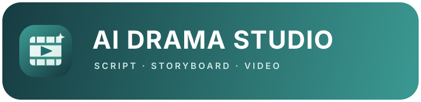

**이야기를 숏드라마로 만드세요.**

[English](README.md) · [简体中文](README.zh-CN.md) · [日本語](README.ja.md) · **한국어**

[기능](#features) • [제작 과정](#workflow) • [다운로드](#download) • [소개](#about)

[**Windows x64 다운로드**](https://github.com/ComicDrama/ai-drama-studio/releases/download/v0.0.1/AIDramaStudio.Setup.0.0.1.exe) · [공식 웹사이트](https://drama.madongdong.com)

## 대본에서 완성된 에피소드까지

각 단계가 다음 단계를 준비하는 제작 흐름을 따라 작업할 수 있습니다. 필요하면 이전 단계로 돌아가 내용을 수정할 수 있습니다.

1. 대본을 **가져오고 정리**해 프로젝트와 에피소드를 만듭니다.
2. AI로 이야기와 대사를 **다듬고 다시 씁니다**.
3. 캐릭터, 장소, 소품, 캐릭터 음성 참고 자료를 **공유 에셋 라이브러리**에서 관리합니다.
4. 연출 의도, 길이 규칙, 장면 설명, 영상 프롬프트로 **에피소드를 계획**합니다.
5. 장면별 영상을 **생성하고 검토**하며 작업 진행을 확인한 뒤, 클립을 합쳐 에피소드를 내보냅니다.

## 일관된 제작을 위한 기능

- 대본, 에셋, 에피소드, 작업 기록을 프로젝트별로 관리합니다.
- 캐릭터, 장소, 소품 참고 자료를 한 프로젝트 안에서 재사용합니다.
- 캐릭터에 음성 참고 자료를 연결하면 해당 캐릭터가 등장하는 장면에 자동으로 적용합니다.
- 프로젝트 기본 텍스트·이미지·동영상 모델을 설정하고, 필요한 에피소드의 연출 계획을 따로 조정할 수 있습니다.
- 영상 생성 전에 연출 계획이 동영상 모델의 제한을 충족하는지 확인합니다.
- AI Agent가 대본 수정, 에셋 추출, 스토리보드 분할, 프롬프트 작성을 지원합니다.
- English, 简体中文, 日本語, 한국어 UI를 지원합니다.

## 다운로드

첫 데스크톱 버전은 **Windows x64**를 지원합니다. 설치 파일 크기는 약 **143 MiB**입니다.

[Windows x64 다운로드](https://github.com/ComicDrama/ai-drama-studio/releases/download/v0.0.1/AIDramaStudio.Setup.0.0.1.exe)

현재 Windows 설치 파일은 서명되지 않았으므로 처음 실행할 때 Windows 보안 경고가 표시될 수 있습니다. AI 기능은 앱에서 설정한 서비스 제공업체에 연결됩니다. 제공업체 계정, API 키, 사용 요금은 별도입니다.

## 소개

제작: [Lumosylva](https://github.com/Lumosylva) · [공식 웹사이트](https://drama.madongdong.com)

[BSD 3-Clause License](LICENSE)를 따릅니다.
